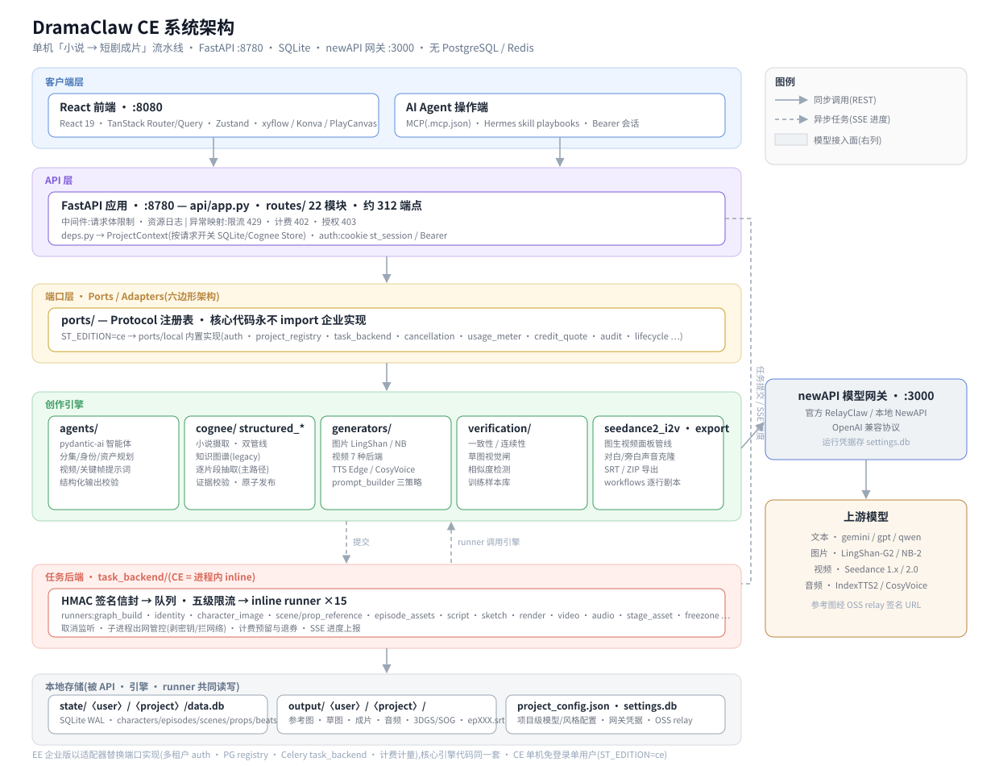
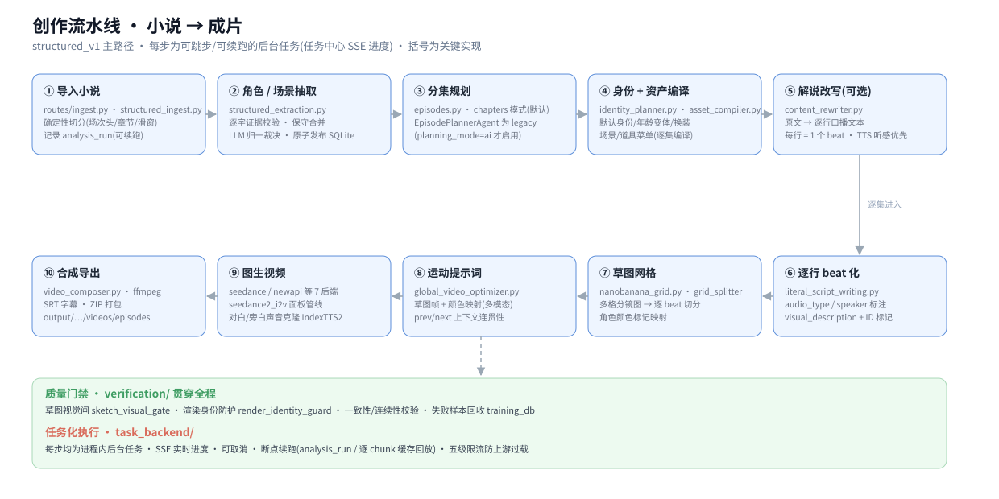
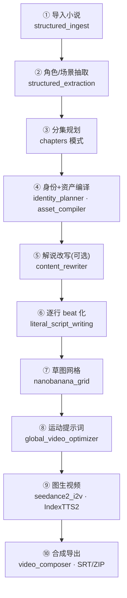

# DramaClaw 项目结构与架构说明

> 依据 2026-10-09 对 `supertale-ce` v2.0.6 代码库的只读走读整理,供开发/运维快速定位代码。
> 架构图:[architecture-system.svg](architecture-system.svg) · [architecture-pipeline.svg](architecture-pipeline.svg)

---

## 一、系统架构



**一句话**:单机「小说 → 短剧成片」流水线 —— React 前端(`:8080`)→ FastAPI 后端(`:8780`)→ 端口层 → 创作引擎/任务后端 → 本地 SQLite(可选 MySQL)+ 文件存储;所有模型调用统一经 OpenAI 兼容的 newAPI 网关(`:3000`)。无 Redis 依赖。

**分层职责**:

| 层 | 位置 | 说明 |
|---|---|---|
| 客户端 | `frontend/` + `.hermes/` `.mcp.json` | 浏览器 SPA;AI Agent 经 MCP/REST 直操 API |
| API 层 | `src/novelvideo/api/` | `app.py` 组装应用;`routes/` 22 模块约 312 端点;`deps.py` 注入 `ProjectContext`;cookie `st_session` / Agent Bearer 双凭据 |
| 端口层 | `src/novelvideo/ports/` | 约 20 个 Protocol;`ST_EDITION=ce` → `ports/local/` 内置实现;核心代码永不 import 企业实现(有 lint 门禁) |
| 创作引擎 | `agents/` `cognee/` `structured_*` `generators/` `verification/` `seedance2_i2v/` `workflows/` `export/` | 规划、生成、校验、导出(见流水线图) |
| 任务后端 | `src/novelvideo/task_backend/` | CE 为进程内 inline:HMAC 签名信封 → 队列/五级限流 → runner ×15 → SSE 进度/取消/断点续跑 |
| 存储 | `state/` `output/` | 关系数据默认每项目一个 SQLite;`NOVELVIDEO_DB_DSN` 配置 `mysql://` 时全部自研存储切到单库 MySQL(按原文件路径哈希做表名前缀,见 `db/`);素材与成片按目录组织 |
| 模型接入 | `config.py` `model_gateway_*` | 全部文本/图片/视频/音频模型走 newAPI 网关,凭据存 `settings.db` 不进环境变量 |

**流水线**(数据流视角):



同构 Mermaid(可在 GitHub/IDE 渲染):



---

## 二、顶层目录

```text
dramaclaw/
├─ src/novelvideo/        # Python 后端(发行名 supertale-ce,CLI 命令 novelvideo)
├─ frontend/              # React 19 SPA(Vite 6 + TanStack + Tailwind 4 + shadcn)
├─ tests/                 # pytest 套件(322+ 文件,另有 contract/ 与 ports/ 子目录)
├─ scripts/               # 运维/验收/lint 脚本(acceptance、lint_banned_words、backup…)
├─ docs/                  # 中英双语文档 · changes 变更记录 · superpowers 设计稿 · dev/(本目录)
├─ examples/              # 示例
├─ assets/                # README 配图 · 架构 excalidraw 源文件
├─ deploy/sandbox/        # 子进程沙箱二进制与 Seatbelt 策略(macOS)
├─ .github/workflows/     # 11 条 CI:ci / frontend / secret-scan / banned-words / ce-import-lint…
├─ .hermes/              # AI Agent 操作入口:SKILL.md + playbooks + API references
├─ .mcp.json              # MCP 配置(Agent 走 REST 操作流水线)
├─ docker-compose.yml     # 源码构建入口(api/web 本仓 + 网关取 ../dramaclaw-gateway)
├─ docker-compose.release.yml  # 运行定义真身(env/端口/卷/健康检查),上面文件 extends 它
├─ pyproject.toml         # uv 依赖 · ruff 豁免基线 · pytest markers(m01–m10/ee/e2e)
├─ ce-allowlist.toml      # CE 治理允许清单(import lint / 禁用词豁免)
├─ DESIGN.md              # 前端设计系统源(与 frontend/src/index.css 变量镜像,改 UI 必读)
└─ AGENTS.md              # 仓库协作规范(结构/测试/提交/安全)
```

---

## 三、后端 `src/novelvideo/` 子包地图

| 子包/模块 | 职责 | 关键文件(规模) |
|---|---|---|
| `api/` | FastAPI 应用与 REST 路由 | `app.py`(479) · `routes/freezone.py`(14814★) · `routes/generation.py`(6377) · `deps.py`(403) |
| `agents/` | pydantic-ai 创作智能体 ×12 | `structured_extraction.py`(1713★) · `asset_compiler.py`(1663) · `identity_planner.py`(1495) |
| `cognee/` | 小说摄取与知识图谱(legacy 管线) | `store.py`(2400+) · `pipeline.py` · `config.py`(大量网关 monkey-patch) |
| `structured_*` 根模块 | structured_v1 主路径:切分/抽取/构建 | `structured_extraction.py` · `structured_builders.py` · `story_analysis.py` |
| `generators/` | 图片/视频/TTS 生成与提示词组装 | `video_generator.py`(4000+,7 后端) · `nanobanana_grid.py`(4300★) · `prompt_builder.py`(3800) |
| `seedance2_i2v/` | Seedance 2.0 图生视频面板管线 + 声音克隆 | `assets.py` · `prompt.py` · `voice_clone.py` |
| `verification/` | 质量门禁:一致性/连续性/草图闸/训练库 | `routes.py`(12 条 verify 端点) · `sketch_*.py` · `training_db.py` |
| `task_backend/` | 进程内任务系统 | `run_core.py`(1105) · `envelope/signing`(HMAC) · `runners/`×15 · `limits.py` |
| `ports/` | 端口 Protocol + CE 本地实现 | `__init__.py`(get_port 门面) · `local/`(auth/registry/usage…) |
| `workflows/` | 逐行剧本工作流 | `literal_script_writing.py`(1474) |
| `freezone/` | 自由创作画布后端(节点/资产/任务) | `canvas_store.py` · `jobs.py` · `style_templates.py` |
| `director_world/` | 3DGS / 导演视角场景(SHARP/全景) | `scene_360_builder.py` · `pano_sharp.py` · `store.py` |
| `chat/` | 对话创作助手(WebSocket) | `service.py` · `hermes_sdk.py`(Agent 后端抽象) |
| `export/` | 成片导出辅助 | `episode_export.py`(SRT/ZIP) |
| `audio/` | beat 音频任务 | `indextts2_beat_audio_task.py` |
| `storage/` `services/` `utils/` `shared/` `security/` `backup/` `ui/` `skills/` `prompts/` | 支撑层(prompts/ 目前是 6 行 stub) | `utils/async_ops.py` 等 |
| 核心单文件 | 存储/配置/任务状态 | `sqlite_store.py`(核心表) · `config.py`(1417,env 于 import 时固化) · `project_config.py` · `task_state.py` · `cli.py`(590) |

---

## 四、前端 `frontend/`

```text
frontend/src/
├─ main.tsx / routeTree.gen.ts     # 入口与自动生成路由树(TanStack Router)
├─ routes/
│  ├─ _app/projects.$project/      # 产品主流程:
│  │   ingest → characters → styles → episodes.$episode/
│  │     {overview · script · beats · sketches · audio · video · compose}
│  │   freezone / tasks / assistant
│  └─ login · checkout · recharge · watch.$work   # EE 面向的路由
├─ index.css                       # 设计系统 CSS 变量(与 DESIGN.md 镜像)
└─ public/locales/{en,vi}          # i18n 文案
```

技术要点:React 19 + Vite 6 + TanStack Router/Query + Zustand;画布用 `@xyflow/react`,草图编辑用 Konva,3DGS 预览内嵌 PlayCanvas;浏览器端媒体处理带 ffmpeg.wasm/mediabunny;测试 Vitest + Testing Library + msw。

---

## 五、数据与运行时布局

```text
$NOVELVIDEO_DATA_ROOT(默认当前目录;Docker 固定 /data)
├─ state/<username>/<project>/
│  ├─ data.db              # 项目 SQLite(WAL):characters/episodes/scenes/props/beats/
│  │                       #   sketch_failure_modes/convergence_rounds/story_analysis_*/entity_evidence
│  ├─ project_config.json  # 项目级模型/风格/声音配置(原子写+flock;Windows 无 fcntl)
│  └─ …task_envelope_keyring.json(0600,单机自动生成)
├─ output/<username>/<project>/
│  ├─ characters/ scenes/ props/    # 立绘 · master/pano/360 场景图 · 道具三视图
│  ├─ sketches/ audio/epXXX/        # 草图与 beat 配音
│  └─ videos/episodes/epXXX.mp4(.srt/.zip)
├─ runtime/                         # 日志等运行态
└─ settings.db                      # newAPI 网关地址与运行 token(模型凭据不进 .env)
```

全局还有:`task_states` 任务表、`image/audio/video_request_usage` 用量表、`chat_*` 会话表、验证侧 `accepted_sketch_samples`/`reject_buffer` 训练表(各自 SQLite)。

**MySQL 后端(可选)**:`NOVELVIDEO_DB_DSN` 配置 `mysql://` 时,上述全部 SQLite 逻辑库映射到单个 MySQL database——每个原 SQLite 文件按相对路径哈希派生一个表名前缀(`t_<hash>__`,全局库如 settings/projects/verification 用 `g_*__` 固定前缀),schema 由 `db/ddl_translate.py` 从原 SQLite DDL 自动翻译、`db/schema_runner.py` 用 `GET_LOCK` + `mv_schema_migrations` 台账做幂等迁移,原文件路径登记在 `mv_scopes`。SQLite 仍是缺省后端,不配 DSN 行为不变。历史数据用 `scripts/migrate_sqlite_to_mysql.py` 一次性导入。

---

## 六、测试与工程化约定

- **测试**:`uv run pytest`;默认排除 `ee`/`e2e` 标记;`pytest-asyncio` auto;契约测试在 `tests/contract/`,端口测试在 `tests/ports/`;模块标记 `m01`–`m10` 对应 OSS 拆分模块。
- **Ruff**:规则集冻结为默认子集;`pyproject.toml` 中的 per-file 豁免是「存量基线」——门禁只拦新增违例,修一处须删一条豁免防回潮。
- **CE 治理**:`ce-allowlist.toml` + `test_ce_imports_lint` 保证核心不依赖企业代码;`banned-words` lint(REPO-07)约束对外措辞。
- **安全**:gitleaks pre-commit;任务子进程默认剥密钥环境变量、拦网络参数;上传/请求体限额在 `app.py` 中间件。
- **新文档**:REUSE.toml 以 `**` 通配聚合声明许可,新增文件默认继承 Elastic-2.0,无需单文件 SPDX 头。

---

## 七、建议阅读路线

1. `docs/zh/concepts/architecture.md` — 官方架构综述
2. `src/novelvideo/api/app.py` — 应用组装与横切关注点
3. `src/novelvideo/task_backend/run_core.py` — 任务执行/结算主循环
4. `src/novelvideo/structured_ingest.py` → `agents/structured_extraction.py` — 主路径摄取与抽取
5. `src/novelvideo/workflows/literal_script_writing.py` — beat 化主流程
6. `src/novelvideo/task_backend/runners/sketch.py` → `render.py` → `video.py` — 生成三连
7. `src/novelvideo/generators/video_generator.py` — 模型后端抽象
8. `frontend/src/routes/_app/projects.$project/` — 前端如何消费以上能力

> 已知坑速查:config 于 import 时固化 env;每请求开关 Store(读路径传 `load_graph_state=False`);freezone 音频超限返回 200+ok:false;`%2F` 还原致 `{name}` 路由 404(资产名自愈的根因);大文件定位建议按 tag/前缀 grep。
